<p align="center">
  <picture>
    <source media="(prefers-color-scheme: dark)" srcset="docs/brand/radian-logo-dark.svg">
    
  </picture>
</p>

<p align="center"><strong>Real-time fleet telemetry &amp; dispatch.</strong><br>
See every vehicle live, and send the nearest driver by real drive time.</p>

Drivers stream GPS from a Flutter app, a Go backend ingests and stores it in TimescaleDB +
PostGIS, and a Next.js dashboard renders the live fleet with MapLibre + deck.gl.

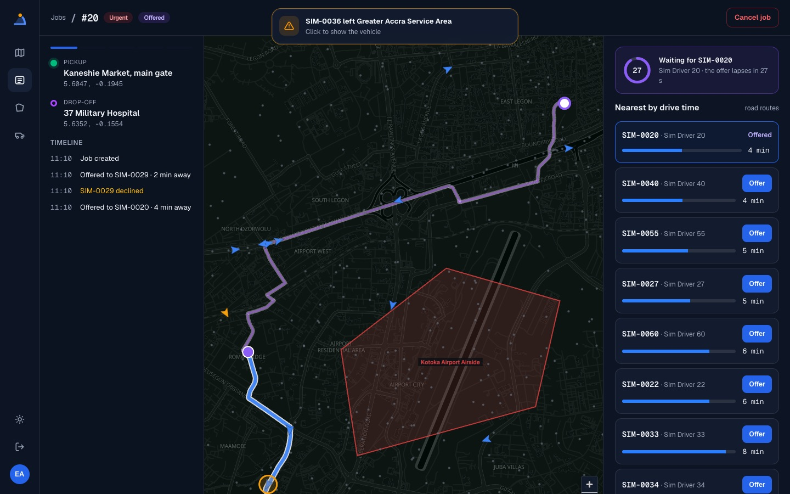

## Screenshots

### Dispatch console

| | |
|---|---|
| 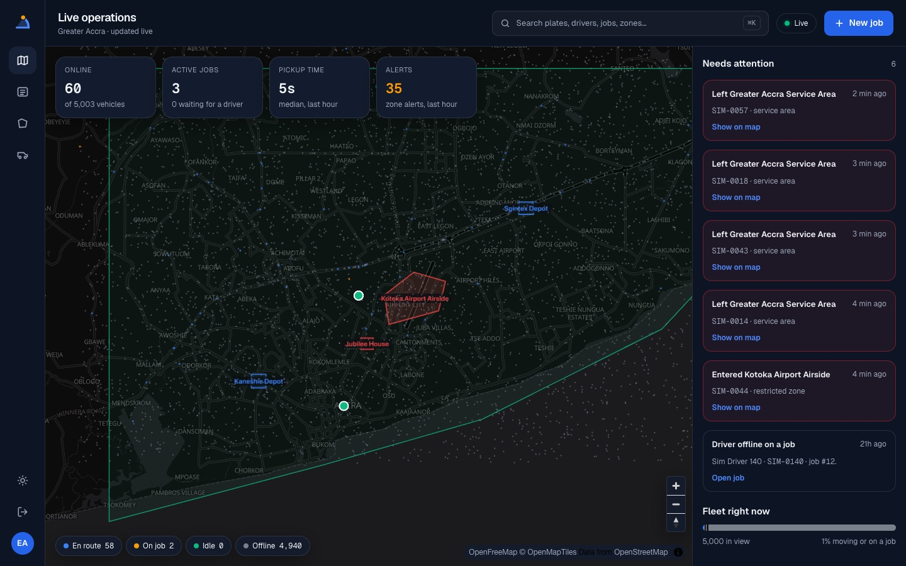 | 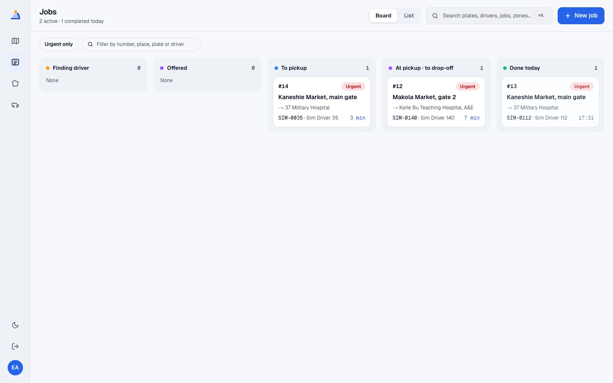 |
| **Live.** Fleet KPIs over the map, and a "Needs attention" queue: offers about to lapse, jobs with no driver, zone alerts, drivers gone offline mid-job. | **Jobs.** A board by stage (finding a driver, offered, to pickup, to drop-off, done today), or a filterable list. |
| 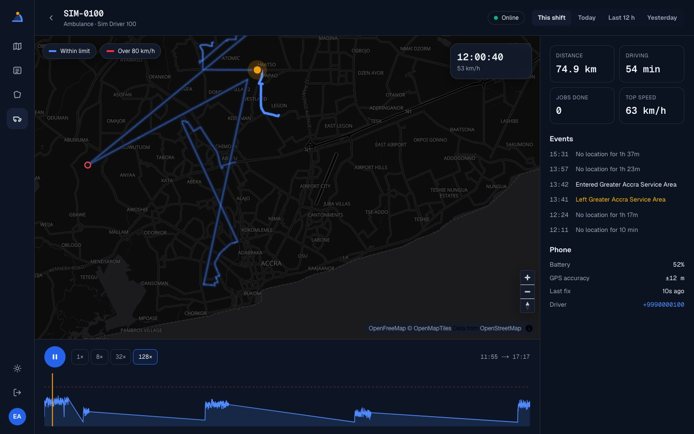 | 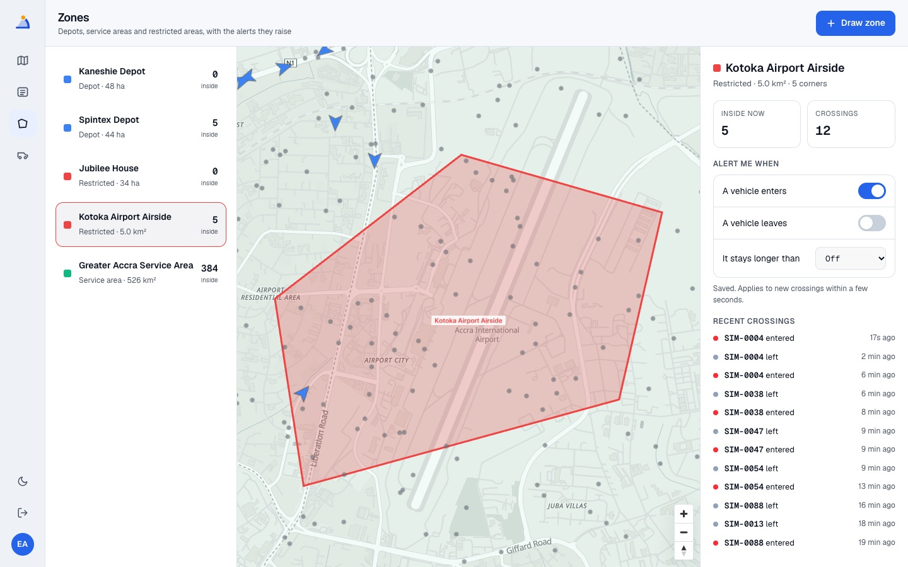 |
| **Vehicle replay.** Play back any shift or time window at up to 128×, with distance, driving time, speeding, stops and signal gaps. | **Zones.** Draw depots, service areas and restricted areas; choose per zone whether entering, leaving or lingering raises an alert. |
| 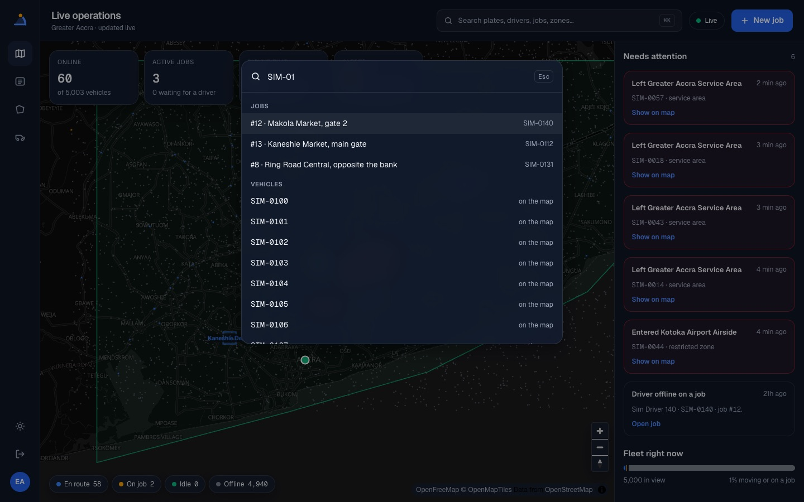 | 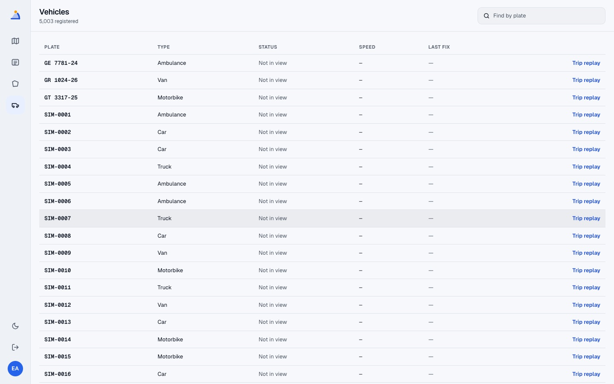 |
| **⌘K** jumps to any plate, driver, job or zone. | **Vehicles.** Every vehicle with its status, driver, battery and last fix. |

<p align="center">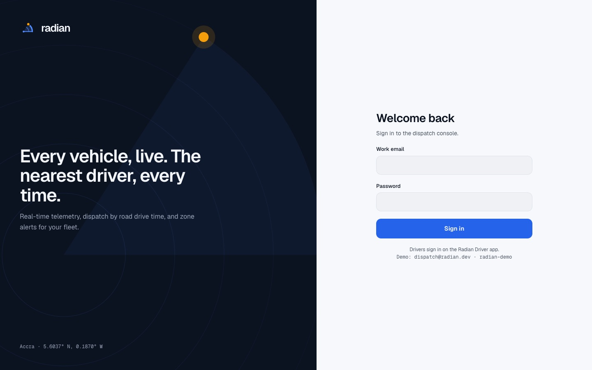</p>

### Driver app

<table>
  <tr>
    <td width="33%">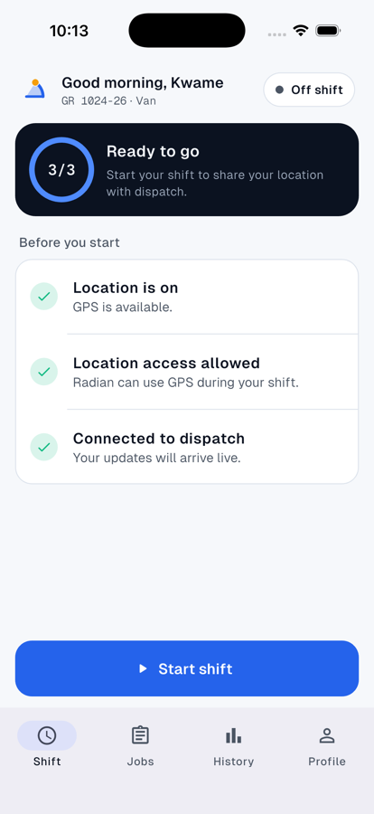</td>
    <td width="33%">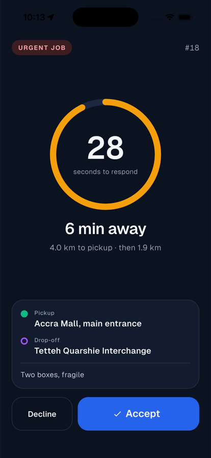</td>
    <td width="33%">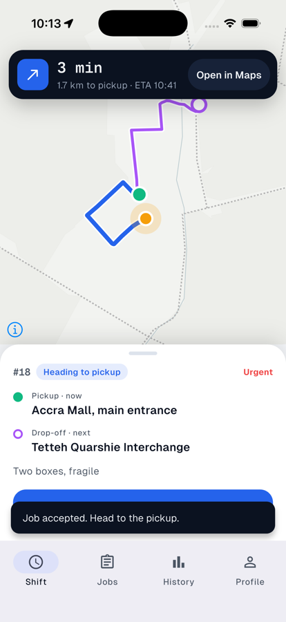</td>
  </tr>
  <tr>
    <td><b>Off shift.</b> A readiness check (location, battery saver, background limits) before Start shift.</td>
    <td><b>Job offer.</b> Full screen, with the stops, drive time and a countdown before it moves to the next driver.</td>
    <td><b>Navigate.</b> The road route to the pickup, then the drop-off, with one button for the next step.</td>
  </tr>
  <tr>
    <td>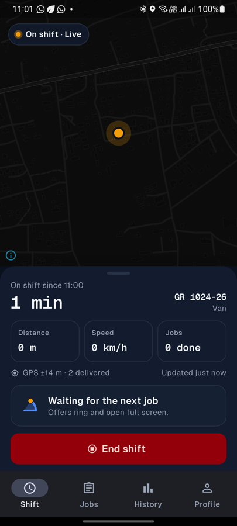</td>
    <td>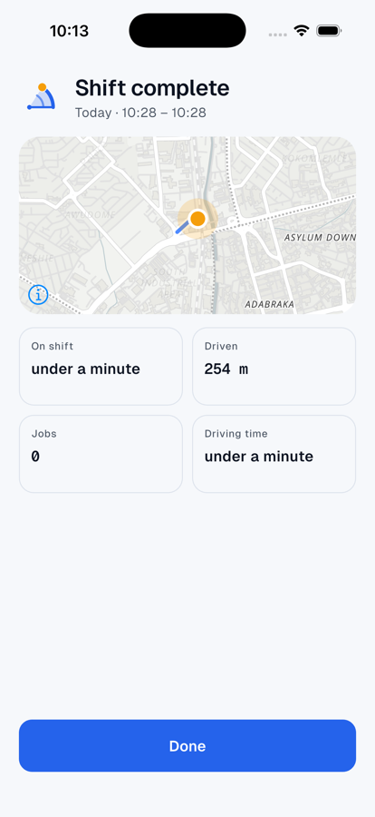</td>
    <td>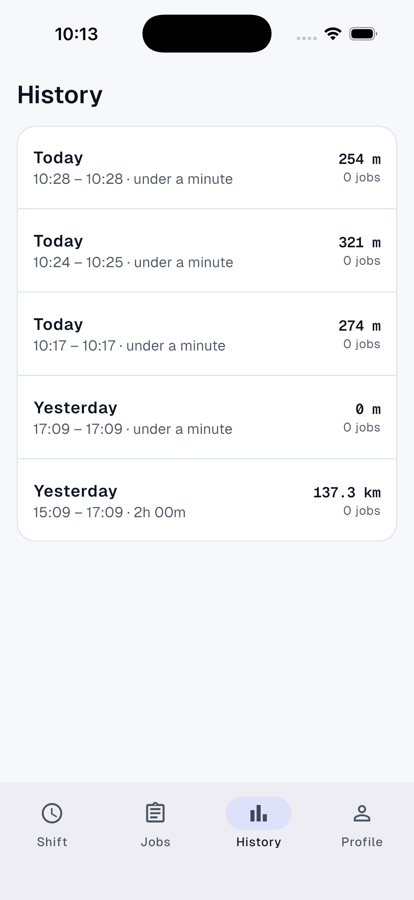</td>
  </tr>
  <tr>
    <td><b>On shift</b> (Android, dark). The amber dot is you: the live vehicle on the dispatcher's map.</td>
    <td><b>Shift complete.</b> Distance, driving time and jobs, with the route driven.</td>
    <td><b>History.</b> Past shifts; tap one for its route and totals. Also Jobs and Profile tabs.</td>
  </tr>
</table>

The phone screens come from the integration-test tour, which signs in, drives a simulated route
and ends the shift: `mobile/tool/tour.sh ios <simulator-udid>` (or `android <serial>`), with the
backend running.

## Architecture

```
Flutter driver app ──(protobuf / WebSocket)──> ingest (Go) <── job offers (Redis Pub/Sub) ── api (Go)
                                                                                           │ dispatch:
                                                                                           │ PostGIS KNN + OSRM drive times
Flutter driver app ──(protobuf / WebSocket)──> ingest (Go)
                                                 │ XADD
                                                 ▼
                                          Redis Streams ──> persister (Go) ──COPY──> Timescale + PostGIS
                                                 │      └──> geofencer (Go) ── zone enter/exit ──┐
                                                 ▼                                               ▼
                                          broadcast (Go) ──(protobuf / WebSocket)──> Next.js dashboard
```

## Brand

<picture>
  <source media="(prefers-color-scheme: dark)" srcset="docs/brand/radian-logo-dark.svg">
  
</picture>

The mark, the **Sweep**, is a sector exactly one radian wide: its arc is as long as its radius.
It reads as dispatch sweeping a search radius from an origin and landing on the nearest live
vehicle, the amber dot. Night Ink `#0B1220`, Radian Blue `#2563EB`, Signal `#4F8BFF` (the mark on
dark), Live Amber `#F59E0B` (the live vehicle, plus the on-job status and warnings; never a background) and Paper `#F6F8FB`; type is Geist with
Geist Mono for plates, coordinates and counts. The mark is drawn in code on both sides
(`web/src/components/Brand.tsx`, `mobile/lib/ui/brand.dart`), so it stays sharp at every size.

## Layout

```
Radian/
├── backend/   Go services (ingest, persister, broadcast, geofencer, api) + fleet simulator
├── web/       Next.js dispatcher dashboard (MapLibre + deck.gl)
├── mobile/    Flutter driver app
├── proto/     Wire contract shared by all three (`make proto`)
└── infra/     docker-compose and SQL migrations
```

Generated protobuf code lives inside each side that uses it: `backend/gen`, `web/src/gen`,
`mobile/lib/gen`.

Local ports: Postgres `5434`, Redis `6380`.

## Getting started

Requires Docker, Go 1.25+ and [buf](https://buf.build/docs/installation).

```bash
cp .env.example .env              # then set JWT_SECRET (openssl rand -hex 32)
make osrm-data                    # once: Ghana road network for routing (~10 min)
make up                           # Postgres + Redis + OSRM + migrations
make seed                         # demo accounts and zones (password: radian-demo)

# one terminal each
make api                          # REST: sign-in, jobs, dispatch on :8080
make ingest                       # device WebSocket ingestion on :8081
make persister                    # Redis Streams -> TimescaleDB
make broadcast                    # dashboard fan-out on :8082
make geofencer                    # zone enter/exit alerts
make simulator ARGS="-n 1000"     # fake fleet driving around Accra
make web                          # dashboard on http://localhost:3000

curl localhost:8081/metrics
make psql
```

## Dispatch

1. A dispatcher creates a job on the dashboard (click pickup and optional drop-off on the map).
2. The api finds available vehicles near the pickup: online in the last 2 minutes, with a driver
   assigned, not already on or offered a job, within 30 km (PostGIS `ST_DWithin` + KNN `<->`).
3. It ranks them by **road drive time** using OSRM's table service (falls back to a straight-line
   estimate if OSRM is down) and offers the job to the fastest one for 30 seconds.
4. The offer reaches the driver's phone via Redis Pub/Sub → ingest → WebSocket (plus a REST poll as
   a safety net) and an Android heads-up notification.
5. Decline or timeout → the next-best vehicle. No one available → retried every 15 s.
6. The driver works the job: accept → arrived → (to drop-off) → complete. Every step lands in a
   `job_events` timeline, and dashboards are told to refresh via `JobsChanged` pushes.

Row locks (`FOR UPDATE` / `SKIP LOCKED`) keep this safe with several api instances; a partial
unique index guarantees a vehicle can only have one active job.

Demo logins: dashboard `dispatch@radian.dev`, driver app `0240000001`, password `radian-demo`.
The simulator's drivers accept ~85% of offers and drive real roads, so dispatch can be watched
end to end.

## Geofences

Dispatchers draw zones on the dashboard (click the corners, then click the first corner to close
the outline). There are three kinds, and each decides what counts as an alert:

| Kind | Alert | Logged only |
|---|---|---|
| Restricted | a vehicle **enters** | exits |
| Service area | a vehicle **leaves** | entries |
| Depot | none | arrivals and departures |

Those are the defaults; each zone's rules can be changed in the console (alert on enter, alert on
exit, and alert when a vehicle stays inside longer than a set time).

The `geofencer` reads `telemetry:raw` in its own consumer group and tests each fix against the zones
in memory (bounding box first, then point-in-polygon). GPS noise at a boundary would otherwise
cause a burst of enter/exit pairs, so a fix only counts when it is farther from the edge than its
own accuracy, and a crossing needs two such fixes in a row. Confirmed crossings go to
`geofence_events` (with a unique index so a replay after a crash is a no-op). Who is inside each
zone right now is kept in Redis sets, which give the dashboard its live counts and let a restart
pick up where it left off. Alerts reach dashboards through broadcast as toasts, a pulse on the
map and an activity feed.

PostGIS validates every outline (`ST_IsValid`), so a self-crossing shape is rejected with a clear
message instead of producing wrong results later.

## Web console

Next.js + MapLibre (OpenFreeMap tiles, no API key) + deck.gl. A multi-page console: Live, Jobs
(board, list, new job, per-job dispatch), Zones and Vehicles (detail with track replay), with a
⌘K palette and light and dark themes. Fleet state lives outside React in a mutable store; a
`requestAnimationFrame` loop interpolates every vehicle between fixes and pushes fresh layers to
deck.gl, while React re-renders the panels at 2 Hz. Markers are sized in meters (clamped in pixels)
so the fleet stays readable from city to street zoom.

## Backend services

| Service | Role |
|---|---|
| `ingest` | Authenticates devices (JWT, vehicle ID comes from the token), validates and time-orders points, `XADD`s batches to `telemetry:raw`, acks the highest seq so the device can prune its buffer. |
| `persister` | Consumer group on `telemetry:raw`. `COPY`s into a staging table, then `INSERT ... ON CONFLICT DO NOTHING` into the hypertable; acks only after commit and replays its pending list after a crash. |
| `broadcast` | Tails the stream (plain `XREAD`, so every instance sees everything), keeps the latest fix per vehicle, and once a second sends each dashboard only the vehicles that changed inside its viewport. Slow clients are resynced with a snapshot instead of buffering. |
| `geofencer` | Second consumer group on `telemetry:raw`; turns fixes into confirmed zone crossings (see Geofences). |
| `simulator` | One goroutine per vehicle mimicking the driver app: stationary filter, ack-based buffer, random dead zones with backfill on reconnect. |

Measured locally (Intel MacBook Pro, everything on one machine): 5,000 vehicles at a 2s interval
sustain ~2,100 points/s with ingest at ~0.5 core / 240 MB and the persister writing ~5,800 rows
per 2s flush in ~420 ms. Killing the persister with `SIGKILL` mid-run loses nothing.
